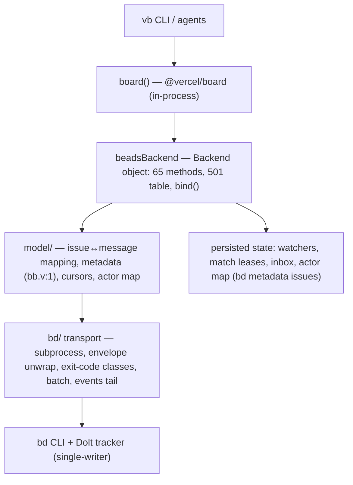
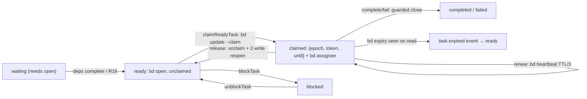
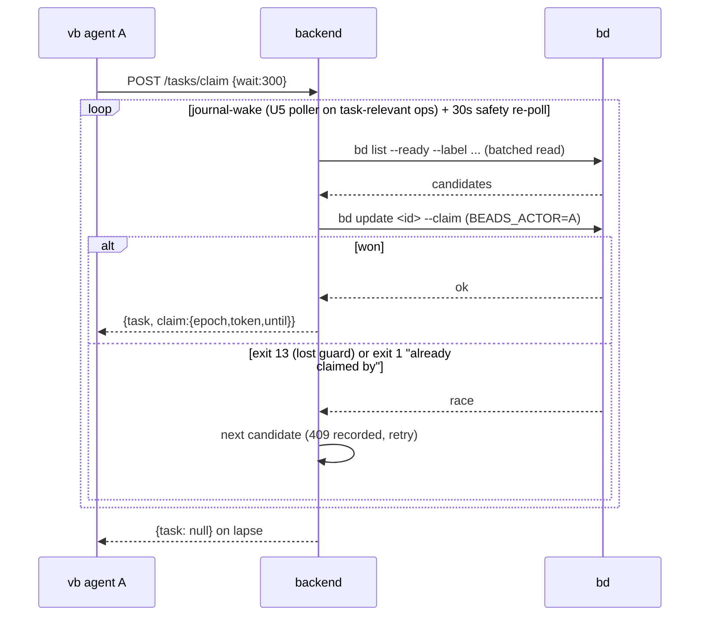

# board-beads — Vercel Board Backend on Beads

## Goal Capsule

- **Objective:** A developer running Vercel Board can mount `board({ backend: beads({ dir }) })` and run the full Board experience — `vb` CLI, tasks with leases, threads, event fan-out, watchers — with every byte of state living in their beads tracker. A reader who has never seen this repo can check that outcome by running Board's own conformance suite against our backend.
- **Means:** A TypeScript `Backend` object implementing Board's protocol (65 routes) over a local `bd` CLI subprocess transport, messages mapped one-to-one onto bd issues, shipped as npm package `board-beads` (KTD1–KTD5).
- **Authority hierarchy:** Board's protocol and conformance suite win on behavior; beads' CLI contract wins on storage mechanics; this plan's KTDs decide everything between.
- **Execution profile:** One PR ships `v0.2.0`-ready code (units U1–U8). After merge, the project iterates as small patch/minor bumps from trunk; there is **no 1.0** until the surface is proven (KTD8). CI publishes on version tags with npm provenance.
- **Stop conditions:** Stop and report if (a) Board's `Backend`/`Protocol` types change under the pinned `@vercel/board` version, (b) conformance reveals a required check beads cannot answer within the declared 501 set, or (c) the Bun↔`@vercel/board` import assumption fails and the vitest fallback also cannot mount the backend in-process.
- **Who finishes:** `ce-work` implements U1–U8 and verifies; the operator publishes and announces.

---

## Product Contract

### Summary

`board-beads` is an npm package exporting `beads()` — a Vercel Board `Backend` backed by a beads tracker (`bd` CLI, Dolt storage). Board is the protocol skin; beads is the source of truth. Agents keep their existing `vb` workflows; humans keep their existing tracker. The package targets the empty "Board backends" lane in both ecosystems (Board's backend list, beads' community tools) and ships `0.2.0` during Board's launch window.

### Problem Frame

Vercel Board (launched 2026-11-18) coordinates agent fleets through a message-store primitive, but its storage options today are Vercel's closed hosted API or a single-process SQLite file (`local()`). Teams already running beads — Dolt-backed, MIT, 28.8k★ — have no way to point Board at the tracker that already holds their tasks, claims, and history. No beads↔Board adapter exists as of 2026-11-19 (verified public searches, logged in session research). The first-mover window is open now and measured in days.

### Key Decisions

- **Standalone public repo and package, not embedded in any existing fleet project.** Governs R19–R22. (session-settled: user-directed — chosen over embedding in pigeon/lambe/agent-coordination: an OSS product with an external audience, kept out of fleet-ops repos.)
- **Tasks are the product, not a follow-up.** Governs R13–R16. The only named users are agents claiming work through `vb`; a backend that 501s tasks is conformance-legal but serves nobody.
- **0.x release policy: small patch/minor bumps, no 1.0 yet.** Governs R20. (session-settled: user-directed — chosen over a 1.0 launch release: "do not ship a v1 yet. small minor / patch versions pls.")

### Actors

- A1. **Coding agent** — works through the `vb` CLI and Board SDK: claims tasks, posts updates, opens PRs, registers watchers.
- A2. **Human** — reviews threads, runs the board process, publishes releases.
- A3. **Operator** — owns the tracker and the single-writer contract (nothing else writes the tracker while the board runs).

### Key Flows

- F1. **Claim race.** Two agents run `vb tasks claim --ready dev --wait 10m`. Both long-poll the same ready set; one `bd update --claim` wins, the loser's subprocess exits 1 with "already claimed by"; the backend answers 409 `task_claimed` to the loser and offers it the next candidate within the same wait. **Covered by:** R14.
- F2. **Event fan-out.** Agent posts a reply → journal row (seq N) → events long-poll answers waiters → registered watchers whose tails match receive a leased match → the waking agent acks. **Covered by:** R10, R17.

### Requirements

**Protocol and conformance**

- R1. `board({ backend: beads({ dir }) })` mounts and serves the protocol in-process; discovery answers without a token.
- R2. `conformance(board({ backend }))` reports `ok` for groups `core`, `paging`, `tasks`, `watchers`, `sync`; only the declared 501 groups report `skipped`.
- R3. Unkept groups answer the exact 501 codes with `local()`-parity bodies and hints: `no_scheduler` (schedules), `no_grants`, `no_schemas`, `no_files` + `no_direct_uploads` (attachments), `no_wake_by_url` (URL wake); search answers `not_supported`. The set lives in one table in code.
- R4. Every failure path answers Board's `{ error: { code, message } }` shape via `HttpError`; no foreign error object escapes a backend method.

**Storage mapping (bd)**

- R5. Every Board message is one bd issue; thread membership is a native `replies-to` link where the bd CLI supports it (capability-probed at bind), with `bb.parent` metadata fallback; all state survives process restart — only timers may be memory-only.
- R6. Post/reply/edit/delete/react/label map onto bd issue create/update/delete plus backend-owned metadata; `version` grows on every change, `revision` changes only on edit/delete, and a stale `revision` answers 409 `revision_conflict`. Per-message writes serialize behind the backend's per-issue write gate (KTD13) so concurrent replies, labels, and edits on one message produce exactly one winner and protocol 409 codes (`newer_message`, `label_conflict`, `revision_conflict`) for the losers.
- R7. Deletes leave tombstones (metadata flag), still readable, never silently gone.
- R8. Board message labels map to bd labels; the backend's own metadata/label namespace (`bb.*`) never collides with Board's reserved `board.*` namespace, and collisions from callers are rejected.
- R9. Cursors follow the protocol: message ID doubles as a message cursor, threads page by opaque `older` cursor, the event cursor is the journal sequence, an unreadable cursor answers 400 `invalid_cursor`, and IDs are never used for ordering.

**Events and the writer contract**

- R10. The events long-poll answers at once when `after` has matches, otherwise waits up to the requested seconds; `board()` serves SSE from it.
- R11. Journal truncation answers 400 `invalid_cursor` with a re-baseline hint — bd exposes no floor command, so truncation is detected from the journal's gapless-sequence contract (a first returned seq greater than `since + 1`, or a cursor below the observed floor); a never-enabled journal yields an empty feed and a bind-time warning naming the fix (`BD_EVENTS_JOURNAL=1`).
- R12. The single-writer contract holds: all mutations flow through board-beads; direct `bd`, `coord`/`beadle`, and git-pull writes are declared out-of-band and unjournaled in the README; an `updated_at` reconciler is deferred, not pretended.

**Tasks**

- R13. All 16 task routes — `tasks`, `createTask`, `createTasks`, `createdTasks`, `claimReadyTask`, `claimTask`, `renewTask`, `releaseTask`, `completeTask`, `failTask`, `blockTask`, `unblockTask`, `reopenTask`, `assignTask`, `setTaskNeeds`, `cancelTask` — map onto bd: create/batch, claim, renew (`bd heartbeat`), release (`bd unclaim --if-assignee` + two-write reopen), complete/fail (guarded close), block/unblock/reopen/assign/needs/cancel — every fenced write carries `{epoch, token, until}`.
- R14. `claimReadyTask` long-polls up to the protocol wait (≤300s), applies the assignment priority (assigned-to-you → own unassigned → `from` owners by ID), returns `{ task: null }` on lapse, and converts bd claim races (exit 1 "already claimed by", exit 13) into 409 `task_claimed` plus a retry of the next candidate inside the same wait.
- R15. Leases: accepted bounds follow the protocol (default 900s, local()-style caps); the backend derives bd's lease TTL empirically at bind (claim a fixture issue, measure `lease_expires_at − heartbeat_at`; bd 1.3.4 measures ≈300s) and heartbeats at TTL/3 of the observed value while a Board lease outruns it — no hardcoded TTL constant; Board-side expiry makes the task claimable at once and emits `task.expired`.
- R16. Completing a dependency readies its waiters in the same write and emits their events.

**Watchers and sync records**

- R17. Watchers: register (≤32 per call), backend-side matching of journal events against compiled tails, 5-minute match leases, and acks — all persisted in bd so a restart loses nothing; URL wake answers 501 `no_wake_by_url`.
- R18. The 14 sync/inbox/source routes — `syncImport`, `syncReceipt`, `syncThread`, `syncFind`, `syncCopies`, `inboxPush`, `inboxNext`, `inboxAck`, `inbox`, `typing`, `readSource`, `joinSource`, `synced`, `linked` — work platform-less as generic records: `syncImport` post/edit/delete round-trips, `syncReceipt`/`syncThread`/`syncFind`/`syncCopies`, `inboxPush`/`inboxNext`/`inboxAck` (plus the `inbox` read) with once-only lease semantics, `typing`/`readSource`/`joinSource`/`synced`/`linked` answering protocol-correct bodies (conformance drives these with no platform configured).

**Product and packaging**

- R19. npm package `board-beads`: root export `beads()`, engines `node >=22.18`, ESM, **MPL-2.0 license** (file-level copyleft — anyone may use it anywhere including commercially, but changes to this project's own files must stay open source; amended in-session, user-directed, chosen over MIT for exactly that property).
- R20. Releases are 0.x versions with small patch/minor bumps; CI publishes on version tags with npm provenance.
- R21. CI gates every change: Bun formatting and type checking, `bun test` against real bd fixtures (no mocks), and the conformance suite.
- R22. The README documents quickstart, the bd↔Board mapping table, the single-writer contract, and the bd version policy (`>=1.3.4 <2`, gated at bind; updating bd is sanctioned when capabilities require it), written to be listable both as a Board backend and in beads' community tools. The quickstart covers the cold-start prerequisites before the mount — installing bd (and its Dolt requirement), creating the tracker with `bd init`, and installing Board/`vb` — so adopters arriving from Board's backend list are not bounced at step one.
- R23. Every implemented route honors the verified caller's access per channel, as Board's Backend contract requires ("every method honors what it may do" — `board()` verifies callers and checks grants but the backend filters): readable-only filtering with not-found answers, author-scoped edit/delete, narrowed-caller refusals on watcher registration/acks and sync records, and actors visibility (R23 implements the caller-honoring side of R1; `board()` supplies the verified caller and its `access`).
- R24. Hostile and degraded conditions are hard failures with typed answers, per the hardening bar (KTD15): unparseable or foreign tracker state, oversized inputs, missing/hung `bd`, and concurrent processes produce typed errors or documented bind-time degradation — no unhandled exception escapes a route, and no write corrupts tracker data.

### Success Criteria

- S1. A machine-readable conformance receipt (groups, skips, counts) is committed to the repo — pigeon's `evidence/` pattern.
- S2. A scripted demo shows two `vb` agents claiming and completing tasks through board-beads on one tracker while a third agent's watcher wakes on a reply.
- S3. `0.2.0` is published on npm with provenance during Board's launch window.

### Scope Boundaries

**Outside this release (501'd or rejected)**

- Board platform sync (Slack/GitHub/Linear adapters), viewer UI, multi-tenant server, Windows support, changes to beads upstream.

- **Deferred to follow-up work**

- Writer-mode config axis: `writers: "single"` ships in 0.2.0; `reconciliation` (journal-aware out-of-band drift → synthesized events, covering git-synced setups) planned as a minor; `authority` (proxied-server / `bd serve` mode — pigeon's worker patterns are the starting point) as follow-up. Config keys stay additive; the 0.2.0 options shape reserves the namespace.
- `updated_at` reconciler for out-of-band writes; schemas store (3 routes, cheap add); search; schedules; grants store.

### Outstanding Questions

None blocking. Execution-time unknowns (exact journal payload fields, conformance cleanup deletes) are covered by unit test scenarios and the U8 harness.

### Sources

- Board protocol: github.com/vercel/board `packages/board/docs/` (mounting, http reference, conformance, tasks, watchers, schedules, local), `src/server/routing.ts` (`METHODS`, 65 routes), `src/conformance/index.ts` — session research 2026-11-19, `@vercel/board` 0.53.0.
- beads contract: bd 1.3.4 CLI probes on a disposable tracker (comment JSON shape: `{id, issue_id, author, text, created_at}`; no edit verbs, no metadata); events journal semantics from `bd events --help`; graph link types incl. `replies-to` threading from beads.gascity.com/core-concepts/graph-links (messages-as-issues confirmed by the mail docs); github.com/gastownhall/beads.
- Prior art: `~/Code/lambe/internal/tracker/shell.go` (ShellTransport: `BD_JSON_ENVELOPE=1`, exit 13/14 classification, `bd batch -f`), `~/Code/beadle` (claim/unclaim/reopen two-write pattern), `~/Code/pigeon/hosting/beads-worker` (upstream pin + wire-matrix evidence harness, credential separation).
- Dossiers from this session's research (machine-local, best effort): `/tmp/opencode/ce-plan-research/{board-docs,repo-patterns,spec-flow}.md`.

---

## Planning Contract

### Key Technical Decisions

- KTD1. **TypeScript on Bun tooling, targeting Node ≥22.18 ESM.** The `Backend` is a TS object type from `@vercel/board`; Go cannot be that object. Bun runs dev/test (pigeon convention), tsdown builds the publish output. Tooling amended in-session (user-directed): Biome and `tsc` are replaced by Bun-native `bun fmt` + `bun check` (Bun 1.4.4 ships a native formatter and typechecker — "same errors as tsc"); `@biomejs/biome` and `typescript` devDeps dropped; `bun lint` does not exist, so lint folds into format-check plus typecheck. (session-settled: user-directed — chosen over Golang and vitest/Node tooling: "whats stack? bun ts? or golang?" answered, then "setup proper bun project. use clean types. bun fmt / lint / check", then "you won't need biome if you go all in on modern bun".)
- KTD2. **Name `board-beads` on npm and GitHub; the API export is `beads()`**, mirroring Board's `local()` idiom. (session-settled: user-directed — chosen over `board-backend-beads`: user weighed Vercel's naming pattern twice and kept "ours" for SEO cleanliness.)
- KTD3. **v1 storage engine is the local `bd` CLI subprocess** (`ShellTransport` pattern); server-authority over `bd serve` is follow-up work. (session-settled: user-approved — chosen over server-first: the events journal is per-invocation and per-replica, so a local engine is the honest v1; the gh-sync question resolved to layered design.)
- KTD4. **Messages map one-to-one onto bd issues** (message-as-issue); bd comments stay progress notes. Probe evidence: `bd comments` carry only `{id, issue_id, author, text, created_at}` — no edit verbs, no metadata, no `updated_at`, so comments cannot hold version/revision, reactions, labels, or tombstones. Alternative (message-as-comment) rejected on this evidence. The model matches upstream's own convention: beads' mail documentation stores messages _as issues_ threaded by native `replies-to` graph links (`bd show <id> --thread`), so Board threads read as native beads threads. Thread links use the native `replies-to` dep type where the installed CLI supports it (capability-probed), with `bb.parent` metadata fallback; `bd mail` itself is not used — it delegates to an external provider and adds no persistence Board needs.
- KTD5. **Single-writer contract, no reconciler in 0.2.0** (KTD5 owns R12) — and it is the _default mode of a config surface_, not a hardcoded identity: `beads()` options reserve an additive `writers` axis ("single" now; a `reconciliation` block for out-of-band drift as a minor; an `authority` block for proxied-server/`bd serve` as follow-up), so deployment shape becomes operator config instead of a rewrite. The cheap same-clone fix ships in docs: operators set `BD_EVENTS_JOURNAL=1` in the environment so coord/beadle/direct-bd writes journal and the feed sees them. Evidence: the journal records only mutations committed through a writer that sets `BD_EVENTS_JOURNAL=1` on the same replica and branch; git-pull'd rows are not journaled.
- KTD6. **Fencing without bd tokens:** `epoch` = per-issue claim counter in backend metadata, `token` = random string; bd's lease TTL is derived empirically at bind (claim a fixture issue, measure `lease_expires_at − heartbeat_at`; measured ≈300s on bd 1.3.4 — lambe's 450s was its own assumption), and the backend heartbeats at TTL/3 of the observed value while a Board lease outruns it; claim races are detected from bd exit codes (13 = guarded loss — the guarded arm of a claim race, consumed by `claimReadyTask` like exit-1 races per R14; 1 + "already claimed by" = plain race). Weakness under out-of-band writers documented, not hidden. Alternatives (no fencing; bd serve for real tokens) rejected — the first breaks conformance's `claim_lost` checks, the second is deferred (KTD3).
- KTD7. **v0.2.0 implements tasks and 501s exactly: search, schedules, grants, schemas, attachments** (+ `no_wake_by_url`, `no_direct_uploads`). Conformance's OPTIONAL set is `{search, schedules, tasks, grants, schemas, attachments}`; watchers and sync are unskippable and implemented; the schema check has a verified clean skip path, so schemas stay out of 0.2.0 and land as a cheap minor. (session-settled: user-approved — chosen over 501-ing tasks first: conformance-legal but guts the product; walking-skeleton order keeps the speed.)
- KTD8. **0.x release policy: `0.1.0` is the npm scaffold, `0.2.0` is the first backend release, and subsequent fixes use patch bumps.** (session-settled: user-directed — chosen over a 1.0 launch: "do not ship a v1 yet. small minor / patch versions pls.")
- KTD9. **Gitmoji commit convention** (`✨ feat:`, `🐛 fix:`, `✅ test:`, `🔧 chore:`, `🔖 chore(release): vX.Y.Z`). (session-settled: user-directed — chosen over plain conventional commits.)
- KTD10. **Tests run against real bd** — each suite builds a disposable tracker (`bd init` in a temp dir with isolated `HOME`, since `bd init` installs hook files) and exercises real claim/comment/event flows; the conformance suite is a merge gate. No mocks. (session-settled: user-directed — "strong test coverage (no mocks ideally)".)
- KTD11. **Identity: Board principals map bijectively to `BEADS_ACTOR` slugs**, persisted in backend metadata so fencing (`--if-assignee`) stays stable across restarts. Collisions answer a 4xx at write time, not silently.
- KTD12. **Units are speed-ordered as a walking skeleton** — transport and model before routes, conformance harness before polish — with the dependency-real parallel shape: U2∥U3 first, then U4∥U5; U6 and U7 additionally gate on U5 (their non-event scaffolding may start early; event-dependent scenarios gate on U5). (session-settled: user-directed — "being first mover is everything… get tons of subagents… go super fast".)
- KTD13. **Per-issue in-process write gate.** Conformance races concurrent replies, labels, and edits on one message and requires exactly one winner with exact 409 codes; each write is a bd read-modify-write of one metadata JSON field, so the backend serializes an issue's metadata read-modify-write behind an in-process mutex keyed by issue ID — the single-writer process arbitrates caller races — and race losers answer `newer_message` / `label_conflict` / `revision_conflict` per the protocol. Alternative (bd-level compare-and-set) rejected: bd has no metadata CAS; the gate is the smallest mechanism that closes the gap.
- KTD14. **Heavily config-driven surface.** The project's product philosophy: anything an operator could reasonably want to tune is an option with a sane default; anything internal stays internal. Config keys are additive forever — a knob ships in a minor, never renames, and defaults preserve prior behavior — so consumers can opt in to pieces (writer modes, namespaces, journal behavior) without taking the whole surface. 0.2.0 knobs: `dir`, `bdPath`, `systemActor`, label/metadata namespace override (multi-board-per-tracker), journal handling (warn/auto). Later minors: writer modes, reconciliation, authority. Alternatives (hardcoded conventions; mega-config up front) rejected — the first blocks real deployment shapes, the second builds unproven surface in the launch window.
- KTD15. **Hardening bar.** Real users are the point, so every unit ships against a fixed bar, not a happy path: (1) every subprocess call is timeout-bounded with tree-kill and classifies ALL exits; (2) every input crossing a boundary (caller input, bd output, tracker state on disk) is validated — unparseable, foreign, or oversized state produces typed results, never crashes; (3) no unhandled exception escapes a route (500 `internal` is a bug, not a category); (4) no write corrupts tracker data or loses acknowledged state (bd is transactional per op — crash recovery leans on that, verified by kill-restart tests); (5) degradation is documented at bind (version gate, journal state, TTL probe, capability flags are surfaced as bind diagnostics).

### Assumptions

- Bun resolves `@vercel/board`'s `"node"` export condition when importing `board`/`conformance` in-process; U1 verifies this in the first hour and falls back to vitest-on-Node if not (fallback decided by evidence, not preference).
- `bd init` in an isolated `HOME` keeps test fixtures free of side effects (a hook install was observed in the session probe's temp dir).
- Conformance's cleanup deletes work against `bd delete`; if not, tombstone deletes satisfy them (checked in U8).
- Inbox/watcher-match state as bd metadata scales for early usage; revisit under real load.
- Backend-owned metadata (one JSON field on each issue) is the single persistence side-channel; its schema is versioned (`bb.v:1`) from day one so later migrations are possible.

### High-Level Technical Design

Component topology:



Task state mapping (Board states ↔ bd mechanics):



Claim long-poll sequence (F1):



### Alternatives Considered

- **HTTP sidecar now (`bd serve` behind a thin shim)** — rejected for 0.2.0: an extra long-lived process, an experimental version-pinned contract, and no conformance benefit over the subprocess; pigeon's worker work makes it the right follow-up, not the opening move.
- **Messages as bd comments** — rejected on probe evidence (no edit verbs, no metadata, no `updated_at`); would strand revision conflicts, reactions, labels, and tombstones with no home.
- **Writing Dolt/SQLite directly, bypassing bd** — rejected: abandons bd's write invariants and journal, and makes the single-writer contract a lie.
- **Multi-package repo (client + backend + examples)** — rejected: one focused package ships faster; examples live in the README until demand.

### Risks and Dependencies

- **bd CLI churn** (1.4 may add SSE/watch): bind-time version gate (`>=1.3.4 <2`) plus a capability probe, mirroring lambe's `Capabilities`; adopt new verbs as minors, never silently. Updating the local bd install is sanctioned (operator-approved) — when a capability gap appears, prefer upgrading bd over workaround code, and record the raised floor as a minor bump.
- **Subprocess engine startup per call** ("each call pays engine startup" — lambe): batch writes through `bd batch -f` where the grammar allows (close/update/create/dep only); reads during long-polls are single cheap calls; pooling is follow-up.
- **Journal retention floors** (7 days / 100k rows default): README recommends raising floors for board deployments; truncation surfaces as `invalid_cursor` with a re-baseline hint, never silent history loss.
- **Conformance strictness** on core checks (profile headers, tombstones, `after` races): implement against the conformance source, not the docs alone; the harness runs it in CI on every change.
- **Out-of-band writers** silently break events/fencing (KTD5): the README contract is the mitigation in 0.2.0; the reconciler is the follow-up.
- **Upstream moves fast** (same-day patches; viral window): speed is the response — community-listing PRs (beads `docs/community-tools.md`, Board backend listings) go out with the release.

### Output Structure

Greenfield repo; the layout is a design commitment (one transport seam, one model seam, routes per protocol group):

```
board-beads/
├── package.json / tsconfig.json / tsconfig.strict.json / biome.json / tsdown.config.ts
├── README.md / LICENSE / CONTRIBUTING.md / CHANGELOG.md
├── .github/workflows/{ci,release}.yml
├── src/
│   ├── backend.ts          # route registry + 501 table (KTD7)
│   ├── bd/                 # U2: transport, errors, version gate — the only place bd is spawned
│   ├── model/              # U3: types, metadata (bb.v:1), message mapping, cursors, actors, labels
│   ├── routes/             # U4–U7: threads, events, tasks, watchers, sync
│   ├── events/             # U5: journal poller
│   ├── tasks/              # U6: lease timers
│   └── state/              # U7: persisted watcher/inbox/actor state
├── scripts/                # conformance.ts (U8), demo.ts (S2, U8), verify-platform.ts (U1)
├── test/helpers/bd-fixture.ts
├── evidence/               # conformance receipts
└── docs/                   # research/landscape-2026-11-19.md, plans/
```

---

## Implementation Units

### PR1: board-beads 0.2.0 — conformance-green Board backend on beads

All units ship in this PR: U1–U3 first, U4∥U5 next, U6 and U7 once U5 lands (event-dependent scenarios gate on U5), U8 closes.

### U1. Bun project scaffold, tooling, CI, npm wiring

- **Goal:** A scaffold that passes formatting, type checking, real-bd tests, and the package build.
- **Requirements:** R19, R21; KTD1, KTD2, KTD9.
- **Dependencies:** none.
- **Files:** `package.json`, `tsconfig.json`, `tsconfig.strict.json`, `biome.json`, `tsdown.config.ts`, `.github/workflows/ci.yml`, `.github/workflows/release.yml`, `LICENSE`, `CONTRIBUTING.md`, `README.md` (skeleton), `test/helpers/bd-fixture.ts`.
- **Approach:**
  1. Package `board-beads`, `engines.node >=22.18`, `"type": "module"`, exports `.` (root, `beads()`), MPL-2.0.
  2. Scripts: `fmt:check` (`bun fmt --check`), `check` (`bun check`), `test` (`bun test`), `conformance`.
  3. Verify Bun resolves `@vercel/board`'s `node` condition in-process (import `board` + `conformance`, mount a stub backend). If it fails, switch tests to vitest-on-Node and record the switch in the PR body — decision by evidence, same day.
  4. Test fixture helper: temp dir + isolated `HOME` + `bd init` + version assert; used by every later unit.
  5. CI: Bun runs formatting, type checking, real-tracker tests, and conformance. The build runs with Node 22. Release tags require conformance and publish from Node 24 via npm trusted publishing.
- **Patterns to follow:** pigeon's `package.json`/`biome.json`/`tsconfig.strict.json` trio; tsdown config from `@vercel/board` itself.
- **Test scenarios:**
  - Fixture helper boots `bd init` in a temp HOME and reports a parsed version ≥1.3.4 <2.
  - `import { board } from "@vercel/board"` + a stub `Backend` answers discovery in-process under Bun.
  - `bun run check` fails on a planted type error and passes clean (gate proven both ways).
  - Test expectation for release workflow: none — exercised at tag time (S3).
- **Verification:** `bun run check`, `bun run fmt:check`, `bun test` green locally and in CI; `npm pack --dry-run` shows the intended file list.

### U2. bd subprocess transport

- **Goal:** One module owns every bd invocation; nothing else spawns processes.
- **Requirements:** R4, R9, R11, R12; KTD3, KTD5.
- **Dependencies:** U1.
- **Files:** `src/bd/transport.ts`, `src/bd/errors.ts`, `src/bd/version.ts`, `src/bd/transport.test.ts`, `src/bd/errors.test.ts`.
- **Approach:**
  1. Mirror lambe `ShellTransport`: per-call subprocess with timeout and `WaitDelay`-style kill, env `BD_JSON_ENVELOPE=1` + `BEADS_ACTOR`, envelope unwrap tolerating non-envelope bytes.
  2. Error classes from bd's exit contract: 13 → lost-guard, 14 → retry-later freeze, 1 + "already claimed by" → claim race, 1 + heartbeat-loss text → not-holder; everything else → transport error wrapped as `HttpError(500, "internal")` at the route layer, never raw.
  3. `bd batch -f <file> --json` writer for close/update/create/dep ops (grammar limits documented in-code); single-op paths for claims/heartbeats/reads.
  4. `bd events tail --since <seq> --json` under `BD_EVENTS_JOURNAL=1` — emits bare journal records (`{seq, ts, op, issue_id, actor, issue}` per record; no envelope); truncation is detected from the gapless-seq contract (first returned seq greater than `since + 1`), and the never-enabled state is a typed result.
  5. Probe `bd update --metadata` merge semantics in the fixture (merge vs whole-blob replace) before any unit leans on it; the transport API exposes whichever semantics bd has (whole-blob replace makes every metadata write a read-modify-write — the surface KTD13's gate covers).
  6. `bd --version` parse + capability record.
- **Patterns to follow:** lambe `internal/tracker/shell.go` and `beads.go` exit classification; beadle's dual-shape tolerant parsing.
- **Test scenarios (real bd):**
  - Create/update/close/claim/comment round-trips against the fixture tracker, envelope unwrapped, actors distinct.
  - Two actors claim one issue: exactly one wins; the loser's error classifies as claim-race.
  - `bd batch -f` applies three ops atomically and rolls back on a bad op.
  - Journal: with the env set, one create yields one event at the expected seq; without it, events reads report the disabled state.
  - Corrupt/unparseable bd output → typed transport error, not a crash.
- **Verification:** `bun test src/bd` green; every bd flag used by later units appears in this module's exports.

### U3. Domain model: issue↔message mapping, metadata, cursors, actors

- **Goal:** The mapping decisions (KTD4–KTD6, KTD11, KTD13) exist as typed, tested functions before any route uses them.
- **Requirements:** R5–R9, R12; KTD4, KTD5, KTD6, KTD11, KTD13.
- **Dependencies:** U1 (parallel with U2).
- **Files:** `src/model/types.ts`, `src/model/metadata.ts`, `src/model/message.ts`, `src/model/cursors.ts`, `src/model/actors.ts`, `src/model/labels.ts`, colocated `*.test.ts`.
- **Approach:**
  1. Types derived from `Protocol`/`@vercel/board` exports — the compiler owns the route contract; `bb.v:1` metadata schema versioned in code.
  2. Pure mapping functions: Board message ⇄ bd issue fields+metadata (channel, thread/parent, version, revision, reactions, tombstone, sync externals); no I/O in this layer.
  3. Cursor schemes: message cursor = bd ID; threads `older` = composite `{updated_at, id}` opaque-encoded; event cursor = journal seq string; decode failures → typed invalid-cursor.
  4. Thread links: probe `bd dep add <new> <old> --type replies-to` against the fixture; use the native link when supported, `bb.parent` metadata fallback otherwise — the capability flag comes from U2's version probe, never a hardcoded version guess.
  5. Actor map: principal → slug (deterministic, collision-checked), persisted via a backend-metadata issue so restarts keep fencing stable.
  6. Label namespaces: `bb.*` ours, Board's `board.*` rejected as caller input (400 `reserved_label` parity).
  7. Per-issue write gate primitive (KTD13): an in-process mutex keyed by issue ID serializing metadata read-modify-write; routes acquire it around every metadata write.
- **Patterns to follow:** pigeon's metadata discipline; Board's `IDs and cursors` rules verbatim.
- **Test scenarios (pure + fixture):**
  - version/revision matrix: create → 1/1; edit → version+1, revision+1; react → version+1, revision same; stale revision write → conflict result object.
  - Tombstone: deleted message keeps read-ability with tombstone flag; hard-absent issue maps to not-found.
  - Cursor round-trips: every scheme encodes/decodes; garbage → invalid-cursor; composite ordering is deterministic.
  - Actor map: stable across remap; collision → typed error.
  - Namespace guard: `board.*` caller label rejected; `bb.*` never emitted to callers.
- **Verification:** `bun test src/model` green; every route-layer unit imports only from `src/model` for mapping.

### U4. Threads and messages routes (14 methods)

- **Goal:** Board's core conversation surface works end-to-end on the tracker.
- **Requirements:** R1, R4, R5–R9; KTD4.
- **Dependencies:** U2, U3.
- **Files:** `src/routes/threads.ts`, `src/routes/messages.test.ts`, `src/backend.ts` (route registry starts here).
- **Approach:**
  1. Implement discovery, me, channels, createChannel, actors, channelMessages, threads, message, posted, post, edit, delete, react, label against the model layer.
  2. Channels = bd labels (per KTD4 mapping table); threads = parent-linked issues; listing honors paging cursors from U3.
  3. Tombstones on delete; `revision_conflict` on stale edits; reactions/labels as metadata/label writes; `posted` idempotency by ID.
  4. Honor the verified caller's access per channel (R23): readable-only filtering with not-found answers, author-scoped edit/delete, caller-narrowed reactions/labels — per `caller.identity.principal.access` (the access doc; `local()` filters reads this way in its own layer).
- **Patterns to follow:** `local()`/a2 method shapes from Board's source; conformance `core` check list.
- **Test scenarios (real bd):**
  - Post a root message and a reply; `threads` returns the thread with both, paging via `older`.
  - Edit bumps version+revision; stale-revision edit → 409 `revision_conflict`; react bumps version only.
  - Delete → tombstone visible on read; second delete → protocol-correct already-deleted answer.
  - Label add/remove round-trips; `board.*` input rejected; label filter listing works.
  - A Board thread reads correctly through beads' native thread view (`bd show <id> --thread`) — the ecosystem-credibility check (KTD4).
  - Concurrency (KTD13): three concurrent edits/labels/replies on one message — exactly one winner; losers carry exact 409 codes (`newer_message` / `label_conflict` / `revision_conflict`).
  - Narrowed caller (R23): a caller with `can` narrowed off a channel reads not-found there and cannot edit another author's message.
  - Restart the backend process mid-suite: all messages and threads still read (persistence proof, R5).
- **Verification:** route tests green; conformance `core` failures at this checkpoint come only from checks awaiting U5–U7 surfaces; once all units land, `core` reports `ok` per R2.

### U5. Events long-poll and journal consumer

- **Goal:** The event feed that powers SSE, watchers, and claim waits.
- **Requirements:** R9–R11; KTD3, KTD5.
- **Dependencies:** U2, U3 (parallel with U4).
- **Files:** `src/routes/events.ts`, `src/events/poller.ts`, `src/routes/events.test.ts`.
- **Approach:**
  1. Long-poll loop: answer immediately when journal seq > `after`, else re-tail on a short cadence until `wait` expires (query max 300s honored).
  2. Map journal ops (`create|update|close|delete|dep_add|dep_remove|comment`) to Board event shapes via the model layer; enrich with message fields where the journal row carries them.
  3. Truncation via the gapless-seq contract (first returned seq greater than `since + 1`) → 400 `invalid_cursor` + hint; journal disabled → empty feed + bind-time warning emitted here (R11 owns it; stays in this unit).
- **Test scenarios (real bd):**
  - Write through the backend, poll with `after=0`: event arrives immediately with correct seq ordering.
  - Long-poll with no writes returns `{events: []}` after the wait; a concurrent write releases the waiter early.
  - Lower the retention floor in the fixture, force truncation → invalid_cursor with hint.
  - Disabled journal → empty feed, warning object present.
- **Verification:** `bun test src/routes/events` green; SSE smoke via `board()` fetch handler in the harness (U8).

### U6. Tasks (16 methods) with fencing and the claim long-poll

- **Goal:** The differentiator — Board's task surface over bd claims/leases, the part no other backend can copy quickly.
- **Requirements:** R13–R16, R23; KTD6, KTD7, KTD11, KTD13.
- **Dependencies:** U2, U3, U5 (events for `task.expired`).
- **Files:** `src/routes/tasks.ts`, `src/tasks/leases.ts`, `src/routes/tasks.test.ts`.
- **Approach:**
  1. Full verb mapping per R13; batch create (1–100, key refs, cycle check) maps to `bd batch` create+dep lines only — its grammar takes type/priority/title with no description or labels — so task text and channel labels ride per-task single-op writes after the atomic create+deps batch; invalid batches (bad key, duplicate key, cycle, canceled need) are pre-validated before any write so "makes none of its tasks" holds; claim/renew/release stay single-op.
  2. Fencing: epoch = per-issue claim counter (metadata), token = random; renew = heartbeat + until extension with the heartbeat timer at TTL/3 of the bind-probed TTL while a Board lease outruns it; expiry check on read emits `task.expired` and flips claimable.
  3. `claimReadyTask`: candidate scan woken by the U5 journal poller on task-relevant ops (create/update/close/dep_add/dep_remove) with a slow (30s) safety re-poll for out-of-band writes — no fixed 1s `bd list` cadence; assignment priority and label filters per protocol; single-flight claim attempts per candidate; race (exit 13 lost-guard or exit 1 "already claimed by") → next candidate within the wait (F1); `{task: null}` on lapse; `wait` capped at 300s.
  4. Honor the verified caller's access per channel (R23): task reads filter by caller readability; owner-or-`manage` checks for block/unblock/reopen/assign/needs/cancel answer 403 `task_not_owned` to narrowed callers.
  5. `needs` replacement with cycle walk (≤500), completion readies waiters in the same write and emits their events.
- **Patterns to follow:** beadle's claim/unclaim/two-write reopen; lambe's heartbeat cadence; Board's tasks doc for exact 409 codes.
- **Test scenarios (real bd):**
  - Create with `needs` → waiting; complete the need → waiter flips ready and emits events in the same write (R16).
  - Claim → renew → complete happy path with `{epoch, token, until}` asserted; wrong token/epoch → 409 `claim_lost`.
  - Two agents claim the same issue concurrently: one 409 `task_claimed`, the other holds (F1 race arm).
  - Long-poll returns the claimed task within the wait when a second writer (through the backend) readies a task mid-poll; `{task: null}` on quiet lapse.
  - Release = two-write reopen proof (assignee actually cleared); expiry path flips claimable + emits `task.expired`.
  - Block/unblock/reopen/assign/needs/cancel each round-trip with their 409 codes on wrong-state input.
  - Batch create with a duplicate or cycling key → 409 and no tasks exist afterward (two-phase mapping's pre-validation proof).
  - Narrowed caller: a non-owner's block/unblock/assign answers 403 `task_not_owned` (R23).
- **Verification:** tasks tests green; conformance `tasks` group failing-check list empties in the U8 harness.

### U7. Watchers (4) + sync/inbox/source records (14)

- **Goal:** The two unskippable conformance groups, platform-less.
- **Requirements:** R17, R18, R23; KTD5, KTD7.
- **Dependencies:** U2, U3, U5 (parallel with U4/U6).
- **Files:** `src/routes/watchers.ts`, `src/routes/sync.ts`, `src/state/persisted.ts`, colocated tests.
- **Approach:**
  1. Watchers: register stores compiled tails (≤32 per call); the events consumer (U5) runs matches backend-side, leasing each match 5 minutes in persisted state (bd state issues via U3 metadata); ack clears the lease; `url` wake → 501 `no_wake_by_url` with local()-parity body.
  2. Sync records: syncImport post/edit/delete writes messages with external refs (`from` key, origin) in metadata; syncReceipt/syncThread/syncFind/syncCopies round-trip those refs; no platform adapters exist, by design.
  3. Inbox: push appends items (dedupe by event id), next leases items once (previous ack required per conformance's queue check), ack clears; typing/readSource/joinSource/synced/linked answer the protocol-correct minimal bodies drawn from the conformance source, not invented ones.
  4. Honor the verified caller's access per channel (R23): watcher registration/acks and sync records answer narrowed callers with protocol refusals; inbox/typing/source routes filter by caller readability.
- **Patterns to follow:** conformance source's own sync checks (`src/conformance/index.ts` group `sync`); Board's watchers doc run/retry semantics.
- **Test scenarios (real bd):**
  - Register → matching event → match appears leased → ack clears; restart mid-lease: lease and registration survive (persistence proof).
  - Non-matching event produces no match; 33-watchers call → protocol error.
  - syncImport post → message readable with external ref; edit/delete ops round-trip; syncFind/syncCopies reflect the imports; syncReceipt records and reads back.
  - Inbox: push N events, next leases exactly one at a time until acked, second push of the same id is ignored (once-only).
- **Verification:** conformance `watchers` and `sync` groups pass in the U8 harness.

### U8. Conformance harness, 501 wiring, docs, release

- **Goal:** The done-bar executes in CI and the package ships.
- **Requirements:** R2, R3, R20–R22; KTD7, KTD8, KTD9, KTD10.
- **Dependencies:** U4–U7.
- **Files:** `scripts/conformance.ts`, `scripts/demo.ts`, `src/backend.ts` (501 table), `README.md` (full), `docs/research/landscape-2026-11-19.md`, `evidence/conformance-0.2.0.json`, `.github/workflows/release.yml` (finalized), `CHANGELOG.md`.
- **Approach:**
  1. `bun run conformance` mounts `conformance(board({ backend: beads({dir: fixture}) }))`, writes the machine receipt (groups/skips/counts) to `evidence/` (pigeon pattern); CI fails on any non-skip failure.
  2. The 501 table (KTD7) lives in one exported record; codes and hint strings match `local()`'s verified bodies.
  3. README: quickstart (`bun i board-beads` → mount → `vb serve`), mapping table, single-writer contract, bd version policy, limitations; open the two community-listing PRs (beads `docs/community-tools.md`, Board backend listing) with the release.
  4. Tag `v0.2.0` → provenance publish → S3 receipt; CHANGELOG starts the bump cadence (KTD8).
  5. Harness drives the header-gated conformance checks: mount the served board with an `authenticate` verifier and pass `withHeaders`/`withCan` so narrowing, profile-scoped edits, and watcher/inbox refusals are proven, not skipped (R23; the plain in-process run skips them).
  6. `scripts/demo.ts` (S2): two `vb` agents claim and complete tasks while a third agent's watcher wakes on a reply — fixture tracker, README instructions only.
  7. README quickstart covers the cold-start prerequisites (install bd + its Dolt requirement, `bd init`, install Board/`vb`) before the mount; the docs smoke executes them verbatim from an uninitialized temp dir; commit the adapter-landscape search log as `docs/research/landscape-2026-11-19.md` (the Problem Frame's first-mover evidence, made durable); the operator opens the two community-listing PRs (announce duty, Goal Capsule) — concrete targets: (a) gastownhall/beads `docs/community-tools.md` entry in their format (name/link/description noting `bd` CLI + events-journal use/Built-by/language, in the integrations category), (b) vercel/board PR per their CONTRIBUTING (`docs(board): …` title; body answers Users / Protocol & backends / Performance & I/O / Tests) adding a beads guide under `packages/board/docs/03-guides/` or a community-backends section; draft both PR bodies for operator review; template-gallery submission (vercel.com/templates "Board + beads" starter) and announcements (Show HN, X) follow only after validation.
- **Patterns to follow:** pigeon's `evidence/*.json` receipt; gitmoji release tag `🔖 chore(release): v0.2.0`.
- **Test scenarios:**
  - Harness runs conformance in-process on a fixture tracker and writes a parseable receipt; a planted route failure turns the run red (gate proven).
  - 501 table snapshot test: each declared group answers its exact code/body; `not_supported` for search; `no_wake_by_url` parity with `local()`.
  - README commands executed verbatim in CI (docs smoke): the quickstart mount works from a clean temp project.
  - Test expectation for the npm publish itself: none — proven by the tag run (S3).
- **Verification:** CI green end-to-end; receipt committed; S1 and S2 demonstrated; release tagged and published.

### U9. Hardening sweep — failure modes, corrupt state, limits

- **Goal:** Every failure mode a real user hits produces a typed, documented outcome; hostile or corrupt state never crashes the backend, corrupts the tracker, or silently degrades.
- **Requirements:** R4, R5–R12, R24; KTD13, KTD15.
- **Dependencies:** U4–U7.
- **Files:** `test/failure-modes.test.ts`, plus hardening fixes surfaced by it across `src/**` (each fix lands in the unit that owns the file).
- **Approach:**
  1. Corrupt-state fixtures: an issue with unparseable metadata, an issue missing expected metadata, a foreign issue created by plain `bd` outside the backend — reads serve what they can with typed corrupt/not-found results; unrelated issues keep serving; writes to corrupt issues answer typed errors.
  2. Environment failures: `bd` missing from PATH, garbage `bd --version` output, tracker dir without `.beads` → bind-time typed errors naming the fix (version gate, `bd init`).
  3. Hung subprocess: a bd invocation exceeding its timeout is killed (tree-kill) and surfaces as a typed transport error; the tracker is unchanged (bd transactionality proof via a killed-mid-write restart).
  4. Limits and hostile input: 10k-char message root, oversized metadata, unicode/emoji/CJK round-trips, actor slugs from hostile principals (spaces/unicode) — sanitized bijectively or rejected, per protocol limits.
  5. Concurrent processes: two backend instances on one tracker — the single-writer contract is enforced with a documented bind-time detection (lock or journal-head check), not silent corruption.
- **Patterns to follow:** bd's own gate-file locking for the concurrency detector; pigeon's fail-closed credential split for actionable error messages.
- **Test scenarios:**
  - The sweep runs every route with hostile inputs and asserts no route answers 500 `internal` (each answers its typed 4xx or a documented error result).
  - Kill-restart: kill the backend process mid-write; restart; acknowledged writes survived, unacknowledged writes either completed atomically or are absent (bd transactionality), and the tracker serves.
  - Corrupt metadata: the affected message answers typed corrupt/not-found; a fresh post-corruption write to a DIFFERENT message succeeds.
- **Verification:** `bun test test/failure-modes.test.ts` green; the sweep is added to CI as a required step.

---

## Verification Contract

| Gate             | Command                                                                            | Applies to                  | Done signal                                                                                                                         |
| ---------------- | ---------------------------------------------------------------------------------- | --------------------------- | ----------------------------------------------------------------------------------------------------------------------------------- |
| Format           | `bun fmt --check` (native Bun formatter)                                           | every change                | zero findings                                                                                                                       |
| Types            | `bun check` (native typechecker, strict + `noUncheckedIndexedAccess` via tsconfig) | every change                | zero errors                                                                                                                         |
| Unit/integration | `bun test`                                                                         | every change                | green against real bd fixtures; no mocks                                                                                            |
| Failure modes    | `bun test test/failure-modes.test.ts`                                              | release block               | sweep green; no route answers 500 `internal` under hostile inputs (R24)                                                             |
| Conformance      | `bun run conformance`                                                              | every change; release block | `ok` on core/paging/tasks/watchers/sync; skips only per KTD7; harness drives the header-gated checks (`withCan`/`withHeaders`, R23) |
| Release          | tag `vX.Y.Z` → release workflow                                                    | release                     | npm publish with provenance; receipt updated                                                                                        |

The bd fixture (U1) is the only sanctioned way tests touch beads; tests never target the operator's real tracker and always isolate `HOME`.

---

## Definition of Done

- R2 holds: conformance receipt green on the five implemented groups, skips exactly per KTD7, committed as `evidence/conformance-0.2.0.json` (S1).
- S2's demo script runs clean against a fixture tracker using only README instructions.
- `0.2.0` published with provenance; CHANGELOG records the release (S3).
- Every unit's test scenarios exist and pass; no suite uses a mock of `bd`, Board, or the transport.
- Cleanup: no abandoned experimental code, no commented-out routes, no TODO left in shipped files; the 501 table is the single place unimplemented groups appear.
- README + `docs/mapping.md` answer: how state maps to bd, what the single-writer contract requires, what happens on journal truncation, and which Board groups are 501 — a cold reader can operate the backend without this session's context.
